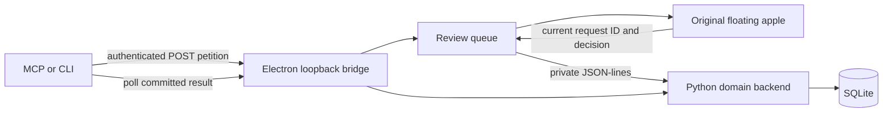

# Architecture and trust boundary

The Python domain layer (`engine.py`) owns request validation, transitions, migration, and SQLite transactions. MCP/CLI adapters do not increment counters. Each approved request contributes exactly one reward; SQLite's unique request IDs make retries idempotent. Streaks increment on approvals, reset on explicit rejection, and ignore cancellation/expiry. History and streaks use a transaction-assigned decision sequence, independent of timestamp ties or clock adjustments. UTC timestamps remain display metadata.

Electron owns the visible review queue. It invokes a managed Python child over private JSON-lines stdin/stdout to persist decisions. A sandboxed, isolated renderer can submit a decision only for its current request ID. Manual requests attach a named recipient window before approval; MCP petitions stay bound to their requesting conversation. Delivery status is tracked separately from the reward decision. Electron checks the sending frame, ignores renderer-supplied task/target data, and waits for a committed result before celebrating. SQLite connections are short-lived and transactional across independent processes. No database is opened when modules are imported.

The bridge requires a random 256-bit token stored as an owner-only regular file. It validates Host, rejects browser Origin headers, limits request bodies, and requires POST JSON for mutation. Clients can submit, read, or cancel petitions; approval is not an HTTP operation. HTTP requests remain bounded even while humans take time to review. The bridge returns only the requested receipt or bounded recent history. The desktop health response identifies both application and protocol version.

This is a workflow boundary, not a sandbox against arbitrary programs running as the same user. Such a program can read local credentials, use Python's domain API, or edit the database. Do not describe the system as tamper-proof. Manual chat delivery on Hyprland uses an explicitly selected destination window, validates address/PID/class/title before focusing and again before typing/submission, and sends a literal gift message requesting an agent reaction. The intended chat input must be selected; the adapter does not inspect browser DOM or terminal panes. Platform adapters cover Hyprland, X11, macOS, and Windows; unsupported sessions use MCP or an explicit copy action. Native validation is separate from adapter contract tests. The renderer never chooses raw OS window handles; there is no recipient picker.

## Lifecycle and failures

`pending -> approved | rejected | cancelled | expired` is a single terminal transition. Repeating the same decision returns its receipt; a conflicting terminal decision is rejected. Expiration is checked transactionally on reads/writes. Pending reviews survive a desktop crash and are shown again only while unexpired. Clients receive an unavailable error on connection failure and attempt cancellation before returning. Startup never grants an award.

One Electron instance owns the bridge. An occupied port or failed backend causes visible startup failure. The app does not delete Chromium locks. Cold launch waits for authenticated readiness before submitting the original task/variety/agent. Logs are local; task text and tokens are not intentionally logged. Global process-presence heuristics are not used. Each adapter targets a specific terminal window. It targets the focused recognized chat or a recent detected agent terminal; an unrelated focused window triggers the picker. Compositor positioning applies only to the feeder window owned by the current process.

## Distribution

The npm distribution owns `openapple`, Electron assets, and the Python source needed to bootstrap an isolated environment. `openapple setup` installs that source into a venv using its Python interpreter, then stores absolute interpreter/module registration. The Python wheel is backend-only and owns `openapple-cli`/`openapple-server`. A locator file connects separately installed Python and desktop distributions; `OPENAPPLE_DESKTOP_DIR` can override it.

Dependencies are locked for development (`requirements-dev.lock` with hashes, `package-lock.json`). Python runtime requirements constrain the tested MCP major. A later MCP v2 migration should be a dedicated protocol-tested change. Release workflows create reviewable artifacts; they do not publish packages or claim native signing.

## Legacy recovery

Migration reads `ledger.json` under a database transaction, validates record types/timestamps and checks that approved history equals the recorded total. Both `task`/`note` and older `task_summary`/`operator_feedback` fields are supported, along with ISO date strings and numeric epoch timestamps. New-submission length and whitespace rules are not applied retroactively to historical text. It writes an exact backup, imports ordered events, and marks migration complete in the same transaction. Original JSON remains untouched. Naive timestamps from old versions retain their local-time interpretation; imported rows retain source `legacy`. A ledger changed by an older process during import aborts the transaction instead of importing a partial snapshot.

If validation fails:

1. Stop OpenApple and copy the original ledger to a separate safe location.
2. Inspect the error and compare `total_apples` against the count of approved history entries. Do not run a script that silently resets either.
3. Reconcile a copy using your actual history, preserving the original elsewhere, then place the corrected copy at `ledger.json` and restart. A failed import transaction adds no partial events.
4. If an existing `.pre-sqlite.bak` differs, preserve both versions and resolve that discrepancy before retrying; it is not overwritten.

To start a separate empty orchard without touching the original, choose a new `OPENAPPLE_DATA_DIR` consistently for desktop and agent. Restore config backups manually from their content-addressed `.openapple-*.bak` files after checking which version you need. Uninstall removes only the registration; backups/history are deliberately retained.

## The apple-to-chat loop

MCP petitions use source `mcp`. The calling client is used to infer a missing agent label where possible; each request gets a distinct receipt. On approval, the waiting client acknowledges receipt through `/received`, and the tool result invites that agent to react in the same conversation. There is no separate model generating a pretend reaction in the overlay.

Manual/CLI feeds are attached to a named chat before approval. The desktop keeps the actual OS target in memory; the database records the recipient label and `sending`, `sent`, or `failed` delivery status. Replays cannot type the gift again. A failed delivery remains an awarded apple with a visible delivery failure, rather than falsely claiming that the chat received it. Recipient selection can be changed only while a manual request is pending.

## Desktop module boundaries

`main.js` loads the application lifecycle. The application owns Electron resources and trusted IPC. The feed coordinator checks the active receipt before focus changes and excludes concurrent decisions. Agent selection runs automatically in the main process. Delivery applies shared identity checks and message construction; platform adapters own discovery, focusing, and literal input. macOS and Windows helper scripts are shipped in the npm artifact, with message data passed as arguments (base64 on Windows), never interpolated into script source.

The feeding surface is the original canvas-only apple. Click/Enter/Space approve; Escape/right-click drop. The tray contains Feed Apple Now, Total Fed, and Quit OpenApple. The force-mute environment setting remains available. Browser and native chat application targeting is excluded from direct delivery.

Original-flow compatibility: when no terminal is detected, manual feeding still records the human click and celebrates, with delivery left `none`. It never types into an arbitrary fallback window. On Hyprland the original recent-window/first-foreground-agent fallback is retained; it cannot disambiguate tabs sharing a terminal process. No chooser is shown. MCP requests remain bound to their origin.
