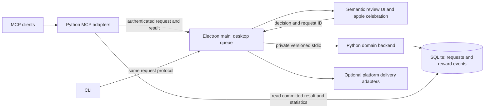

# OpenApple quality review and implementation plan

Reviewed 2026-11-14–15 against commit `2ef364d` (version 0.3.2).

## Assessment

OpenApple has a memorable concept, a small codebase, an existing MCP integration, and a distinctive desktop interaction. It is currently a prototype with substantial correctness and release gaps. The most serious problems affect its central promise: a reward can be granted without a human decision, two runtime paths write inconsistent reward records, and ordinary multi-agent use can lose history.

For a resume, the strongest version of this project is a reliable, accessible local human-feedback system with a clear approval lifecycle, durable storage, tested platform adapters, and reproducible releases. More features will not compensate for failures in those areas.

This review plans fixes; it does not implement production changes. Severity describes project impact, not a formal vulnerability rating:

- **P0:** can destroy user configuration or defeats the human-approval requirement; address immediately.
- **P1:** breaks a primary workflow, persistence, delivery safety, or release confidence; fix before the next public release.
- **P2:** material maintainability, usability, or diagnostic gap; address before presenting the project as polished.
- **P3:** localized cleanup after the substantive fixes.

The review records **28 findings: 2 P0, 12 P1, 13 P2, and 1 P3**. Several share the same architectural cause and should be resolved together, rather than treated as 28 unrelated patches.

## Verification and limits

| Check | Observed result |
| --- | --- |
| Fresh Python dependency resolution | The allowed `mcp>=1.0.0` resolves to MCP 2.3.0; tests fail during collection because `mcp.server.fastmcp` was removed. |
| Existing Python suite with MCP 1.30.0 and pytest 9.2.0 | **5 passed**, Python 3.13.14. Ran with `Path.home()` patched to a temporary directory before importing application modules. |
| Test isolation | The server test creates a real ledger entry named `Wrote tests` inside that temporary directory. The test itself does not isolate the module-global engine. |
| Python wheel build | Succeeds with `python3 -m build --wheel --no-isolation`; wheel has Python modules and entry points, but no JS, HTML, icons, or audio assets. Build interpreter: Python 3.14.7. |
| npm package contents | `npm pack --dry-run --json` succeeds, with 31 files. Python sources are included, but npm does not install the Python project or its dependencies. |
| Existing JavaScript test | `npm test` passes by printing `OpenApple syntax OK`; it does not load application code. |
| Actual JavaScript syntax | `node --check` passes for `main.js`, `preload.js`, and `bin/openapple.js`, Node 22.23.2. |
| Isolated Python reproductions | Confirmed automatic GUI approval, EOF approval, lost ledger updates, corruption reset, unchanged streaks, malformed JSON config replacement, commented TOML false success, silent launcher failure, and dropped cold-start metadata. |
| Desktop logic with Node VM and OS/process mocks | Confirmed unreachable X11 typing, Wayland target returned after failed detection, unauthenticated state-changing bridge requests, and repeated IPC reward recording without sender validation. These are logic reproductions, not native desktop end-to-end tests. |
| UI mechanical detector | Ran against `overlay.html`, `main.js`, and `preload.js`; returned no findings in **degraded regex mode** because parser modules were unavailable. This is not accessibility or security clearance. |

No native macOS/Windows session, actual keyboard injection, live desktop animation benchmark, screen-reader session, or browser-to-loopback exploit was exercised. Platform/API findings below distinguish source evidence from native verification still needed. No real ledger was changed by the audit test runs. The build's incidental tracked metadata change was restored.

## Glaring issues

### F01 · P0 · Approval is granted before the operator decides

**Evidence:** [dialogs.py](../openapple/dialogs.py#L19) calls `launch_gui()`, then immediately returns `(True, ...)`. `launch_gui()` does not return a human decision and can silently return even if nothing launches. The headless exception handler also sets `approved = True`. [server.py](../openapple/server.py#L28) records that result immediately.

**Reproduced:** a no-op launcher with `DISPLAY` set grants approval; an `EOFError` from `input()` also grants approval. Closing or dropping the overlay cannot reverse the already-recorded award.

**Fix:** introduce explicit pending/approved/rejected/cancelled/expired outcomes. Only a validated human approval event commits a reward. Failure, EOF, cancellation, and timeout must never become approval. Show task summary, agent, and variety before the decision. Keep the celebration, but make it follow the decision.

**Acceptance:** no approval event means zero new apples; approve creates exactly one; reject/cancel/expire return their actual outcome to the originating request.

### F02 · P0 · Setup can replace a user's existing configuration

**Evidence:** [installer.py](../openapple/installer.py#L46) treats JSON parse failure as an empty configuration, then overwrites the same file. A non-dictionary `mcpServers` value is also replaced. There is no backup or atomic replacement.

**Reproduced:** malformed pre-existing config is replaced with only the OpenApple server entry, and the function returns success.

**Fix:** validate existing files first; refuse unsupported/corrupt input without changing bytes. Back up valid files before modification, preserve unrelated content, and atomically replace only after validating the result. Return structured errors and a nonzero setup exit code when required targets fail. Provide dry-run and restore/uninstall behavior.

**Acceptance:** corrupt input remains byte-for-byte unchanged; unrelated settings survive installation; a failed write preserves the original; running setup twice is idempotent.

### F03 · P1 · A permitted dependency version breaks the MCP server

**Evidence:** [pyproject.toml](../pyproject.toml#L32) allows every MCP version after 1.0; [server.py](../openapple/server.py#L3) imports the v1-only `FastMCP` path. Installing the declared dependency currently selects MCP 2.3.0 and produces `ModuleNotFoundError` during test collection. The official [SDK migration guide](https://github.com/modelcontextprotocol/python-sdk/blob/main/docs/migration.md) confirms the API change.

**Fix:** immediately constrain the dependency to a tested v1 range, then migrate to v2 in a dedicated change with protocol-level tests. Commit reproducible development resolution and test both the minimum supported dependency and the chosen release version. Do not assume changing the class name completes the v2 migration.

**Acceptance:** a fresh install can start the server and invoke all four tools using a real MCP client.

### F04 · P1 · Ledger updates lose data and corruption is silently erased

**Evidence:** [engine.py](../openapple/engine.py#L18) loads once per instance and rewrites the entire file without locking or atomic replacement. [server.py](../openapple/server.py#L10) holds one engine for the process lifetime. [main.js](../main.js#L23) separately reads and writes that same ledger with different logic.

**Reproduced:** initialize engines A and B on one file, register an award through A, then through B: the final file contains only B's award. Loading `{broken` replaces it with an empty ledger. No parallel threads are needed to reproduce the lost update.

**Fix:** make Python the sole implementation of domain rules and persistence; use SQLite transactions, a schema version, request IDs with uniqueness constraints, and fresh queries for summaries. All desktop mutations must use the same domain API. Import legacy JSON transactionally after validation and retain the original backup. Fail visibly on corruption or permission errors.

**Acceptance:** concurrent processes cannot lose events; interrupted writes cannot destroy history; malformed legacy data is preserved; totals and history agree after restart.

### F05 · P1 · One action can be counted twice

**Evidence:** [cli.py](../openapple/cli.py#L61) records an award before launching the overlay; [server.py](../openapple/server.py#L29) does the same after its premature approval; [main.js](../main.js#L559) records another award when the overlay emits `feed-apple`. No event has a unique request ID or a deduplication check.

**Impact:** the CLI path can increment twice for one visible feed. The MCP path can double-count or overwrite intervening history depending on timing and which stale engine writes next.

**Fix:** one transactional commit operation per request ID, shared by every entry point. Adapters submit requests and render results; they do not independently increment totals. Retry and duplicate delivery must return the existing result.

**Acceptance:** duplicate IPC, HTTP retry, double-click, and process reconnect produce one reward per request ID.

### F06 · P1 · Keyboard target verification does not support the README guarantee

**Evidence:** [main.js](../main.js#L152) uses system-wide process presence plus an application-name allowlist on macOS, Windows, and generic Linux. `requestedAgent` can substitute for actual detection. Generic Linux catches `xdotool` failures and still returns a target. Hyprland traverses every descendant of a window process, which does not identify the foreground tab/pane in a multi-session terminal. [sendRewardMacro](../main.js#L478) uses cached targets and delayed global typing without a final focus/foreground-agent check. Focus activation failures are ignored.

**Reproduced:** generic Wayland returns a `codex` target with `windowId: null` when process output is empty and window lookup fails. Native wrong-window delivery was not attempted.

**Impact:** an unrelated terminal, editor, tab, or newly focused window can receive text and Enter. [README.md](../README.md#L45) promises more than these checks establish.

**Fix:** make keyboard delivery explicitly optional. Define an adapter capability contract that identifies the actual receiving window/session, verifies focus immediately before delivery, and aborts when identity or focus is uncertain. A requested agent is a filter, never evidence. Prefer returning the reward through the existing MCP response for tool-initiated petitions. Keep approved reward state separate from delivery success.

**Acceptance:** failed focus, closed/reused target, unrelated terminal, changed tab, unsupported compositor, and mid-delay focus switch all abort delivery without typing. Where the OS adapter cannot establish that guarantee, disable automatic keyboard delivery and offer a manual copy action.

### F07 · P1 · Platform delivery code has concrete implementation errors

**Evidence:** [main.js](../main.js#L551) checks `process.platform === 'x11'`; Node reports `linux`, so the X11 typing branch cannot run. The Windows FFI declares `bScan` as `uint8_t` and passes UTF-16 code units with `KEYEVENTF_UNICODE` to `keybd_event` ([main.js](../main.js#L14), [main.js](../main.js#L452)). Microsoft's documented Unicode path uses `SendInput` and `KEYBDINPUT`, whose scan field is a `WORD`; `keybd_event` accepts a `BYTE` scan code. See [keybd_event](https://learn.microsoft.com/en-us/windows/win32/api/winuser/nf-winuser-keybd_event) and [KEYBDINPUT](https://learn.microsoft.com/en-us/windows/win32/api/winuser/ns-winuser-keybdinput).

The Windows foreground-query PowerShell here-string is also flattened with `.replace(/\r?\n\s*/g, ' ')`, destroying its [required multiline structure](https://learn.microsoft.com/en-us/powershell/module/microsoft.powershell.core/about/about_quoting_rules#here-strings) ([main.js](../main.js#L201)). That failure is swallowed and an empty foreground result is allowed to proceed.

**Reproduced:** the X11 driver activates a mocked window but never invokes a typing command. Windows findings are source/API analysis and require native validation. The existing X11 `xdotool type ... chosen, 'key', 'Return'` argument construction also needs a native test rather than assuming it sends Return correctly.

**Fix:** isolate platform drivers, fix platform selection, replace invalid Win32 input calls, preserve valid PowerShell syntax, await activation, and propagate failures. If clipboard paste remains a supported fallback, obtain user opt-in and restore clipboard content where feasible.

**Acceptance:** native tests cover plain text, emoji, Enter behavior, missing utilities, denied OS permissions, and clipboard handling on each claimed platform.

### F08 · P1 · The local bridge has no client authentication or request contract

**Evidence:** [main.js](../main.js#L577) accepts `/feed` and `/trigger` regardless of HTTP method, authentication, origin, or parameter size/type. `/status` exposes complete task history. A `User-Agent` header in the Python client does not authenticate it. Bridge probes trust any HTTP 200 on a fixed port.

**Reproduced:** a mocked unauthenticated `DELETE /feed` with a foreign Origin receives 200 and triggers the overlay. This demonstrates missing handler checks, not a tested browser exploit or remote network exposure: the server correctly binds to loopback.

**Fix:** use a narrowly scoped authenticated local protocol: POST JSON for mutations, strict request/response schemas, payload limits, Host/Origin validation where applicable, and a per-installation secret with restrictive permissions. Expose minimal health separately from authenticated history. Verify bridge protocol/application identity during startup. If choosing sockets/named pipes instead, document equivalent access controls.

**Acceptance:** unauthenticated reads/mutations fail; unsupported methods return 405; invalid input is rejected; secrets do not appear in URLs/logs; an unrelated service on the port is not mistaken for OpenApple.

**Boundary:** these controls prevent accidental or unauthorized local-protocol use. They do not sandbox an agent or attacker already able to execute arbitrary code as the same OS user.

### F09 · P1 · Concurrent petitions overwrite or cancel one another

**Evidence:** [main.js](../main.js#L55) stores one global pending request. [toggleOverlay](../main.js#L426) overwrites it, and a second request while visible drops the current apple. There are no IDs, per-request outcomes, timeouts, or queue.

**Fix:** add a bounded request queue with IDs and explicit lifecycle transitions. Show the correct task and originating agent, send the result only to its requester, and define disconnect/timeout behavior. A second petition must never toggle or dismiss the first.

**Acceptance:** two clients submitting together each receive their own decision exactly once, including when one cancels, disconnects, retries, or times out.

### F10 · P1 · The documented installation paths do not form a complete product

**Evidence:** [bin/openapple.js](../bin/openapple.js#L10) runs Python modules from the npm package, but npm installs neither `mcp` nor the Python console script that setup puts into agent configs. The Python wheel omits the desktop assets that [gui.py](../openapple/gui.py#L43) locates relative to `site-packages`. Both package managers publish an `openapple` executable with different command handling. An installed wheel with a global Electron binary can launch Electron against the wrong app root.

**Fix:** choose and document a distribution contract. Recommended: the desktop distribution owns `openapple`; the Python distribution exposes distinct backend/MCP commands; npm setup explicitly bootstraps or locates a compatible isolated Python environment. Desktop assets must be shipped in their designated artifact and discovered through an explicit path/handshake, never by assuming a source checkout sits beside installed Python modules. Verify the Python interpreter and server executable before writing agent configs.

**Acceptance:** on clean environments, each advertised installation path completes setup, starts MCP, displays a request, persists one approval, and survives restart without repo-relative files or preinstalled developer packages.

### F11 · P1 · Cold starts lose request details and launch errors look successful

**Evidence:** [gui.py](../openapple/gui.py#L47) starts the desktop without forwarding task, variety, or agent, then returns before readiness. Its fallback loop also returns no error if every candidate fails. `ensure_tray_running()` reports success after `Popen()`, not after health verification. Child output is discarded.

**Reproduced:** a cold launch receives only `[node, bin/openapple.js]`, and a launcher with no bridge/binaries returns `None` without an error.

**Fix:** launch once, wait for authenticated readiness with a bounded retry policy, then submit the original request unchanged. Resolve the installed application root explicitly. Report typed launch errors, preserve useful diagnostics, and return nonzero CLI exits on failure. Electron's relative `loadFile()` is valid relative to the application root; it is not independently a working-directory bug, per the [API contract](https://www.electronjs.org/docs/latest/api/web-contents#contentsloadfilefilepath-options).

**Acceptance:** warm and cold launches carry identical metadata; missing desktop, dependency failure, crash-before-ready, and arbitrary working directories produce correct, visible outcomes.

### F12 · P1 · Current tests and automation do not establish release quality

**Evidence:** [package.json](../package.json#L15) prints a success string instead of running a test. The Python suite contains five basic tests; [test_server_tools](../tests/test_openapple.py#L28) patches the prompt to approve and uses the module-global engine, which is initialized against the user's home at import. No tracked CI workflow, lockfile, formatter/type-check configuration, or desktop/protocol integration suite exists.

**Fix:** isolate all filesystem/process/display dependencies, remove import-time state creation, and add regression tests for the failures in this review. Add real JS tests for bridge/lifecycle/platform adapters, a real MCP client smoke test, and package-install tests. Establish lint/type checks and a CI matrix. Keep assertions about observable behavior; do not inflate counts with implementation-mirroring tests.

**Acceptance:** test execution changes no real user files, launches no real GUI, and types nothing. A regression in approval, concurrency, target checks, dependency compatibility, or packaged installation fails CI.

### F13 · P1 · Electron is restricted to an unsupported release line

**Evidence:** [package.json](../package.json#L48) declares `electron: ^33.0.0`, which cannot update beyond major 33. As verified during review, the official [release index](https://releases.electronjs.org/) lists stable majors 45, 44, and 43; Electron supports its [latest three stable major versions](https://www.electronjs.org/docs/latest/tutorial/electron-timelines#version-support-policy).

**Fix:** upgrade to a supported major in a dedicated change, inspect intervening breaking changes, commit dependency resolution, and run the platform/security/package tests. Add automated dependency update review. Do not claim a particular exploitable CVE without checking the resolved runtime and reachability.

**Acceptance:** shipped Electron is supported at release time, the dependency tree is reproducible, and platform smoke tests pass.

## Smaller issues and architectural debt

These are grounded in the current implementation; some become easy fixes once the core ownership problem is resolved.

| ID / Priority | Evidence and impact | Fix and acceptance |
| --- | --- | --- |
| **F14 · P1** MCP terminal fallback shares protocol streams | [dialogs.py:29](../openapple/dialogs.py#L29) uses `print()` and `input()` from a stdio MCP tool. It can emit non-protocol stdout and compete for the client's protocol stdin. Direct Python function tests do not exercise this. | Keep stdin/stdout exclusively for MCP framing. Headless MCP returns an explicit unavailable/pending outcome through the protocol; an interactive CLI may use a real TTY. Real-client test verifies no stray stdout and no hang when no human terminal exists. |
| **F15 · P2** Reward schema and statistics disagree | [engine.py:34](../openapple/engine.py#L34) never updates streaks or stores variety; [server.py:33](../openapple/server.py#L33) and [server.py:82](../openapple/server.py#L82) supply different fallback streaks. JS stores UTC ISO timestamps and variety; Python stores local minute timestamps. | Versioned event schema with UTC timestamps, variety, request ID, outcome, source, and optional note. Define streak semantics: approvals increment, explicit rejections reset, cancellation/expiry do not award. All views derive the same totals and streak. |
| **F16 · P2** Setup is not scoped or a validated merge | [installer.py:136](../openapple/installer.py#L136) writes all agent rules even for a single selected target; [installer.py:80](../openapple/installer.py#L80) recognizes TOML by substring. A commented header falsely counts as installed; a stale executable is never repaired. Rule-write failures are swallowed. | Agent adapters with verified config/rule discovery, environment-directory overrides, parsed TOML updates preserving comments, previews/backups, target scoping, and failure reporting. Validate discovery against current official host documentation before claiming support. Test commented/stale/alternate-home configurations and leave unselected agents untouched. |
| **F17 · P2** Diagnostics report presence as health | [installer.py:189](../openapple/installer.py#L189) tries to import Node's `koffi` as a Python module. [installer.py:230](../openapple/installer.py#L230) calls agents active if any config exists, without checking the OpenApple entry. macOS permissions and actual server startup are not checked. | Read-only capability probes in the owning runtime; verify registration, executable, bridge identity, and OS permission state. Add machine-readable doctor output and meaningful exit status. Tests distinguish installed, configured, permission denied, and healthy. |
| **F18 · P2** Single-instance initialization is racy | [main.js:612](../main.js#L612) deletes Chromium singleton files without proving staleness; a health probe precedes lock acquisition and trusts any 200; bridge bind errors are logged while startup continues. | Acquire Electron's instance lock before initialization, forward explicit requests through a verified channel, and fail or recover visibly on bind errors. Do not delete live runtime lock files. Simultaneous launch and occupied-port tests establish one owner. |
| **F19 · P2** CLI behavior depends on which executable wins PATH | npm forwards only selected subcommands ([bin/openapple.js:7](../bin/openapple.js#L7)); `--help`, `overlay`, `gui`, and `button` differ from the Python CLI. `setup` discards extra arguments. Python `feed --agent` says auto-detect but defaults to Claude. A signalled Python child exits as success via `code ?? 0`. | One documented user-facing command contract with standard help/version and exit semantics, consistent aliases, validated agent/variety arguments, and explicit manual-award semantics. Test all advertised commands through the actual packaged executable. |
| **F20 · P2** Renderer carries stale request metadata | [overlay.html:535](../overlay.html#L535) changes task/variety only when present, so a later manual feed inherits the preceding task or variety. A celebration hardcodes Honeycrisp. | Reset complete request state on every spawn from immutable validated defaults; render the selected variety everywhere. Regression: Fuji task A followed by a default manual feed must not retain A/Fuji. |
| **F21 · P2** Privileged IPC accepts renderer authority | [main.js:559](../main.js#L559) trusts arbitrary details, including target information, and does not verify sender, request lifecycle, or repeat delivery. [overlay.html](../overlay.html) has inline script and no CSP. Default Electron isolation settings are not themselves evidence of an exploit. | Main process owns target and request identity; renderer sends only a decision for the current request ID. Validate sender/frame, payload schema, and permitted state transition. Add CSP, restrict navigation/window creation, and explicitly configure secure web preferences. [Electron's security guidance](https://www.electronjs.org/docs/latest/tutorial/security) supports sender validation and CSP. Tests reject forged/replayed decisions and retain approved main-process target data. |
| **F22 · P2** Review UI is inaccessible and hides the work being reviewed | [overlay.html:12](../overlay.html#L12) renders only a canvas plus audio; the task summary is never drawn. Keyboard shortcuts exist, but there are no semantic buttons, accessible labels/status, or review text. | Add a compact semantic approval panel with task, agent, variety, Approve/Reject/Cancel, focus management, and accessible status/error messages. Preserve the animated apple as a decorative celebration. Verify keyboard-only and screen-reader completion manually; no contrast compliance claim until measured. |
| **F23 · P2** Motion/display behavior is not engineered across environments | [overlay.html:23](../overlay.html#L23) ignores device-pixel ratio; [overlay.html:212](../overlay.html#L212) uses per-frame physics; [overlay.html:513](../overlay.html#L513) has no explicit idle-loop control; [main.js:340](../main.js#L340) selects only the primary Linux display. No reduced-motion alternative exists. | Time-based animation with bounded delta or fixed simulation steps, DPR-aware drawing, stop/restart rendering around visibility, cursor-display placement on supported platforms, and reduced-motion celebration. Verify 60/120 Hz timing, 1x/2x clarity, display resize/removal, and idle resource use. Hidden-window throttling may already reduce work; measure before claiming a CPU leak. |
| **F24 · P2** Audio does redundant work and has inconsistent settings | [audio.py:16](../openapple/audio.py#L16) regenerates both sounds on every call, seeds global RNG, and checks mute only at playback. Concurrent callers can overwrite the same WAV files. Renderer audio ignores `OPENAPPLE_SOUND` and uses different assets. | Share a documented mute preference, generate missing versioned files once using atomic creation and a local RNG or ship assets, bound playback subprocesses, and degrade visibly but nonfatally. Verify muted paths avoid generation/playback and concurrent playback cannot corrupt assets. |
| **F25 · P2** Installer scripts make unverified success claims | [install.sh:35](../install.sh#L35) uses bare `pip` instead of the detected interpreter, assumes a special `~/.venv` for symlinks, and does not ensure an isolated environment. [install.ps1:36](../install.ps1#L36) does not check external-command exit codes under the declared PowerShell 5.1 support; shims hardcode `python` even if `py` was detected. | Delegate to one bootstrap implementation with explicit interpreter/environment discovery, executable paths, version checks, external exit checks, and actionable errors. Clean-machine tests cover missing Python/Node, failed npm/pip, paths with spaces, and a `py`-only Windows environment. |
| **F26 · P2** Repository and release contents show local development residue | Git tracks `node_modules/electron` as an absolute symlink into the author's home, generated `openapple.egg-info`, an old source ZIP, and a tooling lock file. No lockfiles, LICENSE text, changelog, contribution guide, or release workflow are tracked. `__version__` is 0.2.0 while manifests say 0.3.2. | Remove generated/machine-specific files from tracking, retain intentional icons/sounds, generate release archives in CI, add license text matching the declared license, synchronize version metadata, and verify package contents from a clean checkout. Do not delete user-local copies as part of untracking. |
| **F27 · P2** Documentation weakens the engineering story | [README.md](../README.md) has no demo, architecture, troubleshooting, development/test commands, support evidence, or limitations. It declares universal support and verified-only typing without corresponding tests. Buff descriptions imply weight/context changes that the implementation does not perform. | Keep the playful apple identity, but explain the actual mechanics: gamified human feedback, local event persistence, MCP results, optional desktop delivery. Separate fictional buffs from technical capabilities. Publish a short demo and measured platform matrix. Any claim of improved agent performance needs a reproducible evaluation; the current repo establishes no such result. |
| **F28 · P3** Small cleanup obscures ownership | [installer.py:125](../openapple/installer.py#L125) contains duplicate `pass`; imports/constants and `launch_gui(engine=...)` are unused; `rich`/`typer` are dev dependencies despite an argparse implementation. Paths and agent metadata are duplicated across runtimes. | Remove verified dead code/dependencies after the ownership refactor, centralize configuration/schema, and add focused docstrings/types at boundaries. Lint passes without blanket suppressions; public compatibility changes are explicit. |

## Target architecture

The central design change is clear ownership. Keep the existing Python + Electron stack; a web framework migration or cloud service is unnecessary.

1. **Python domain layer** owns validated requests, decision transitions, reward events, statistics, migrations, and SQLite transactions. It has no GUI, subprocess, or MCP imports and no import-time filesystem writes.
2. **MCP and CLI adapters** validate input, invoke that layer, and return structured outcomes. Human-oriented text is formatted at the boundary. MCP transport streams remain protocol-only.
3. **Electron main process** owns the desktop request queue, UI lifecycle, and platform capability/target handles. A renderer receives display data and can return a decision for a request ID; it cannot select arbitrary OS targets or author reward totals.
4. **A narrow Python backend interface** lets Electron use the same domain implementation. Prefer a managed Python child with a versioned JSON-lines stdio protocol for desktop persistence, rather than reimplementing the ledger in JS. Multiple Python processes can safely use the same SQLite repository; SQLite transactions and unique request IDs enforce persistence correctness across them. This does not require a new always-running service.
5. **The authenticated desktop bridge** carries petition requests/results between independent MCP adapters and Electron. Desktop UI decisions pass through the Python backend for validation and commit; the MCP adapter returns that existing result instead of recording another event. A shared validated request record correlates desktop and MCP lifetimes. When desktop interaction is unavailable, headless MCP reports that state; it never assumes a human approved.
6. **Platform adapters** expose `detectCapabilities`, `captureTarget`, `verifyTarget`, and `deliver`. Their results distinguish unsupported, unavailable, denied, delivered, and failed. Request approval and keyboard delivery are separate outcomes.

The diagram's direct read denotes the Python repository API, not raw SQL scattered through MCP tools. Define the backend/bridge protocol in a short architecture decision record before implementation. If packaging a managed Python child proves disproportionate, consolidate the product into one runtime deliberately; do not preserve independent JS/Python business rules as an accidental compromise.

The client-facing bridge may submit petitions and retrieve permitted outcomes; it must not expose a general approve/grant endpoint to those same clients. Human decisions originate in the verified Electron UI and travel through the private backend channel. This is a workflow boundary, subject to the same-OS-user limitation described in F08.

### Invariants and data model

- A petition has a stable UUID, task, normalized agent, variety, source/client identity, creation/expiry time, and validated state.
- Lifecycle: `pending -> approved | rejected | cancelled | expired`. Each terminal transition is committed once; duplicate deliveries return the existing outcome. Delivery status is tracked separately.
- A reward event is created only by an approved transition, with a unique request ID. No action grants a reward merely because an overlay was triggered or a process started.
- At commit time, request identity and transition validity are checked inside the same transaction as the reward insertion. A unique reward ID alone is insufficient if invalid transitions remain possible.
- Totals, streaks, and history derive from committed events with one defined ordering. Keep UTC timestamps and a deterministic tie-breaker. Query recent history with pagination rather than rewriting an ever-growing JSON blob.
- Legacy JSON migration preserves originals, validates all records, reports ambiguity, and can be retried safely. Inconsistent counts must be reported with a reconciliation preview; do not silently discard or invent history.
- Store secrets and data in a configurable application directory with restrictive permissions. Support a temporary data directory in tests without changing the OS user's home.
- Cancellation/timeout and backend/desktop crashes must resolve waiting clients within a documented bound. Restart reconciliation expires abandoned pending requests rather than granting them.

## Implementation sequence

Effort ranges are planning estimates for one developer familiar with Python and Electron, including meaningful tests. Native platform access and release signing can extend the schedule. Merge small reviewable changes, but do not publish an intermediate version that still falsely approves requests.

| PR | Scope and order | Findings | Estimate | Completion gate |
| --- | --- | --- | --- | --- |
| **1. Contain immediate failures** | Constrain MCP to tested v1; fail closed on GUI/EOF failure; refuse malformed config writes; temporarily disable keyboard injection until target guarantees exist. Add isolated regressions and document temporary limitations. | F01–03, F06, F14 | 1–2 days | Fresh server import works; no synthetic approval on error; invalid configs unchanged; no unverified typing. |
| **2. Establish repeatable checks** | Remove global engine initialization; inject data/config paths and platform services; replace fake JS test; add basic CI and reproducible dependency resolution. | F12, F26 | 1–2 days | Existing suite and first regression tests run without home writes, GUI, or keyboard side effects; broken test fixtures fail CI. |
| **3. Own the reward model** | Add domain request/decision types and SQLite repository; define statistics; implement legacy import with backups and dry-run reconciliation. | F04–05, F15, F28 | 2–3 days | Multi-process approvals persist once; restart/corruption/import tests pass; all stats agree. |
| **4. Complete the approval protocol** | Add versioned desktop/backend interface, authenticated bridge, per-request queue, cancellation/expiry, structured results, and main-owned targets. Eliminate adapter-side reward increments. | F01, F05, F08–09, F14, F21 | 2–4 days | Two independent MCP clients receive their own decisions; retries, duplicate IPC, timeout, disconnect, and backend crash never grant extra awards. |
| **5. Make distribution intentional** | Resolve executable ownership and Python bootstrap; package/discover desktop resources correctly; implement cold-start readiness with full metadata; align CLI commands and installer scripts. | F10–11, F19, F25 | 2–3 days | Install packaged artifacts into clean temporary environments outside the checkout and complete the documented workflows. |
| **6. Preserve and diagnose host integrations** | Safe JSON/TOML merges, scoped agent rules, backups/uninstall, host config discovery verification, accurate doctor statuses, and failure exit codes. | F02, F16–17 | 1–2 days | Valid/corrupt/stale configs, selected targets, alternate directories, missing executables, and denied permissions behave as documented. |
| **7. Repair platform boundaries and runtime** | Split OS drivers; fix X11/Win32; await/reverify focus; handle unsupported Wayland explicitly; repair instance lifecycle; upgrade Electron and apply security settings. Re-enable optional injection only for verified adapters. | F06–07, F13, F18, F21 | 2–4 days plus native validation | Native safety/delivery matrix passes for every claimed platform; unsupported paths offer a copy action and never type. |
| **8. Make the review experience usable** | Semantic review panel; visible task and agent; reset renderer metadata; accessible outcomes; mute/reduced motion; DPR/timing/display behavior; shared audio policy. | F20, F22–24 | 2–3 days | Keyboard/screen-reader review, default-after-custom requests, muted/reduced-motion mode, multiple displays, and refresh-rate checks pass. |
| **9. Ship the evidence and project story** | Clean tracking; license/changelog/contributing docs; version consistency; demo; architecture/security boundaries; tested support matrix; release workflow and artifact smoke tests. Finish remaining lint/dead code cleanup. | F26–28 | 1–2 days | Release from a clean tag reproduces tested artifacts; README claims are traceable to tests, measurements, or clearly labelled limitations. |

**Dependencies:** PRs 3–5 must agree on the protocol and ownership contract; define it before coding PR3. PR4 relies on PR3's idempotent commits. PR7 re-enables delivery only after the safety tests exist. PR8 uses the real decision lifecycle from PR4. Most platform testing should start early to expose OS-specific limitations; it is not a final-day activity.

Expect roughly **3–5 focused engineering weeks** for this scope, with more time if three-platform distribution/signing must be built from scratch. A narrower release supporting a smaller explicitly tested platform set can ship sooner. An honest support matrix is stronger than an unverified universal-support claim.

## Required verification matrix

| Layer | Required scenarios |
| --- | --- |
| Domain | Approve/reject/cancel/expire; invalid transition; duplicate request/decision; streak/rank boundaries; UTC ordering; input limits. |
| Persistence | Multiple processes recording distinct requests; concurrent replay of one ID; restart after interruption; database busy/unwritable; legacy import valid/corrupt/inconsistent/repeated; backup preservation. |
| Bridge/backend | Authentication; wrong method/origin/host; malformed/oversized payload; unknown/expired request; sender validation; unrelated process on expected port; version mismatch; backend crash. |
| MCP | Real client starts packaged server, lists tools and calls them; two concurrent clients; headless behavior; disconnect/cancellation; protocol-only stdout; bounded waits. |
| CLI/setup | Actual packaged binaries, help/version/exit codes; npm and Python installation order; selected targets only; malformed JSON/TOML; comment preservation; stale registration; dry-run/uninstall; spaces in paths; missing runtimes. |
| Desktop | Cold/warm start; two simultaneous launches; queue while review visible; approve vs drop; metadata reset; app/backend restart; request expiry; no UI when intentionally headless. |
| Delivery | Supported Linux sessions, macOS, Windows; no matching agent; unrelated terminal/editor/tab; focus failure/switch; target close/reuse; Unicode/emoji; permission denial; clipboard preservation where supported. |
| Accessibility/performance | Keyboard-only and screen-reader decision flow; full task text; semantic feedback; mute and reduced motion; 60/120 Hz timing; 1x/2x scale; multiple displays; bounded idle resource use. |
| Distribution | Build wheel/sdist/npm/native artifacts as applicable; inspect allowlisted contents; install outside checkout; smoke-test minimum supported and current runtimes; verify versions and published documentation. |

Use tests for behavioral guarantees, especially failure paths and cross-process behavior. Avoid a blanket coverage percentage as the release criterion. If a coverage gate is added, focus on uncovered approval/persistence/platform decision branches rather than decorative drawing code.

## Overlay audit appendix

Implementation integrity currently fails for a review surface: the animation is product-specific, but the UI cannot show the work it is supposedly approving and has no actual decision/result contract. Preserve the apple illustration and keyboard affordances while correcting the surrounding workflow.

These are provisional **code-level** scores using the Impeccable audit rubric, not a visual benchmark or accessibility certification. A desktop overlay is evaluated for display scaling and desktop interaction, not mobile breakpoints.

| Dimension | Score / 4 | Evidence |
| --- | --- | --- |
| Accessibility | 1 | Enter/Space/Escape work; canvas-only review lacks semantic controls, task content, announcements, and a motion alternative. |
| Performance | 2 | Lightweight local assets and canvas drawing; synchronous OS probes block main-process work, simulation is frame-dependent, idle behavior has not been measured. |
| Display adaptation | 2 | Resizes to window dimensions; no DPR scaling and Linux remains on the primary display. |
| Theming | 2 | Coherent apple palette, but palette/preferences are embedded in drawing code; no high-contrast/motion preference strategy. Dark mode alone is not a requirement for a transparent overlay. |
| Implementation integrity | 1 | Original artwork and a narrow preload API, undermined by false approval, missing review context, and stale metadata. |
| **Total** | **8 / 20** | **Major work needed in review semantics and behavior; visual quality was not scored from a live session.** |

Positive foundations to retain: locally shipped artwork/audio, no remote renderer dependency, loopback binding, a small preload surface instead of exposing the full IPC object, keyboard approve/cancel shortcuts, deterministic rank thresholds, and a compact codebase that can be corrected without replacing the stack.

Suggested UI follow-up order: `$impeccable harden` for actual review/error states, `$impeccable adapt` for desktop scaling/displays, `$impeccable optimize` for timing and visibility, `$impeccable audit` after the fixes, then `$impeccable polish`. These are optional implementation aids; the concrete acceptance criteria above define completion. They can be run individually or together after the core protocol work.

## Resume-ready release gate

- Every P0/P1 finding is resolved, or an affected capability is explicitly disabled with accurate documentation. Accepted limitations have a named boundary and a test proving safe fallback.
- From a clean checkout, documented commands install dependencies, run real tests/lint/type checks, and build the shipped artifacts. CI is required before merging release changes.
- A new user can follow the README and complete one human approval end to end. Cancellation, headless failure, retries, and two simultaneous agents behave correctly.
- No test writes to personal agent configs/history, launches a real GUI unexpectedly, or injects keystrokes.
- Each claimed platform has native validation evidence; untested platforms are labelled experimental. Package support and optional injection support are separate entries in that matrix.
- A 30–60 second demo shows request details, approval, one persisted event, and an accurate orchard view after restart.
- Architecture notes explain why the runtimes are separated, who owns decisions/persistence, the local trust boundary, and how concurrency is handled.
- LICENSE, changelog, contribution instructions, issue templates, and version-consistent release artifacts are present. Public claims match the implementation.
- Resume bullets describe shipped, measured work. Suitable topics after implementation: MCP integration, idempotent approval processing, transactional persistence, accessible desktop UX, and verified OS adapters. Report actual measurements/platform counts; do not invent adoption or performance improvements.

Avoid expanding into leaderboards, cloud accounts, a new frontend framework, or claims about changing neural weights until the existing workflow is dependable and there is a concrete reason for the expansion. The current idea is sufficient for a strong portfolio project when its execution is trustworthy.
